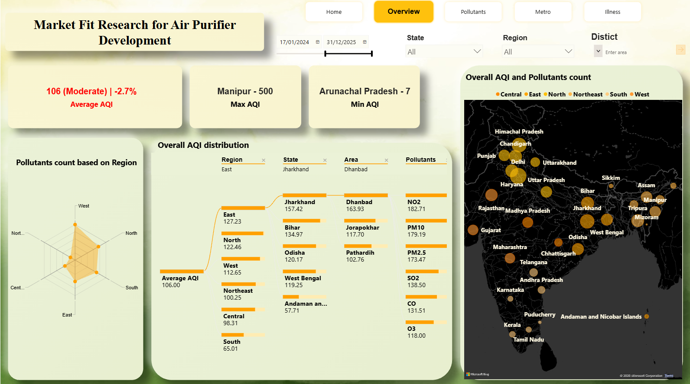
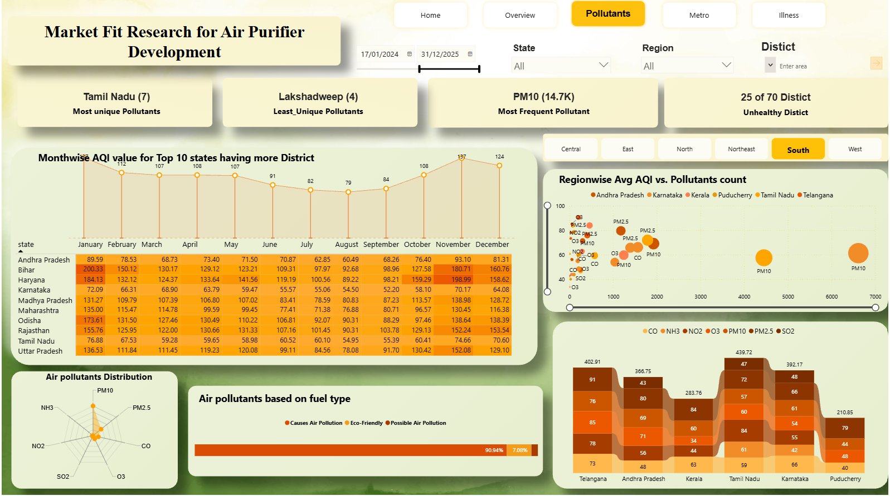
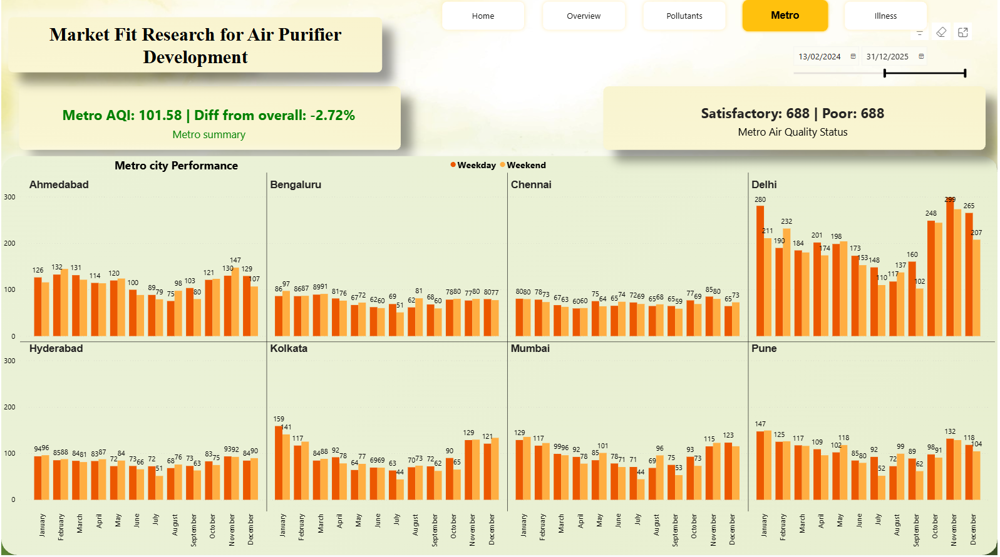
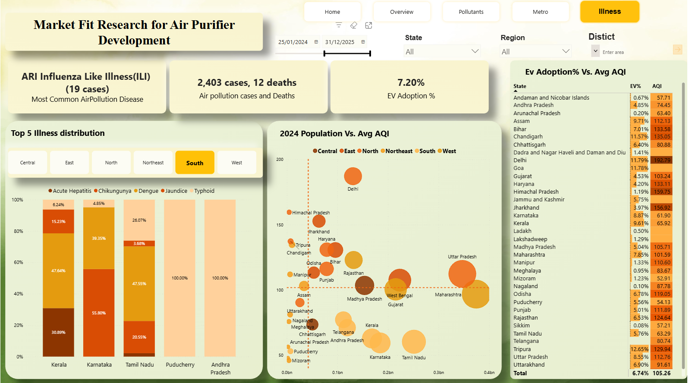

# AirPure Innovations: AQI-Based Market Fit Study for Smart Air Purifiers

An interactive **Power BI** dashboard and presentation that use air quality data to guide the launch of a next-generation, AI-powered air purifier in India. Built for the **Codebasics Resume Project Challenge**, using datasets from **Dataful**.


**[View the Live Dashboard](https://app.powerbi.com/view?r=eyJrIjoiNWFkZjA3ZGUtNTA2Ni00Zjc4LWE3ZjktMGU3YTk5ZDgzNzI5IiwidCI6ImM2ZTU0OWIzLTVmNDUtNDAzMi1hYWU5LWQ0MjQ0ZGM1YjJjNCJ9)** | **[View the Presentation](https://www.canva.com/design/DAGvLPwUxJA/nG26-7GU6vybe5Xv4UM7tg/view?utm_content=DAGvLPwUxJA&utm_campaign=designshare&utm_medium=link&utm_source=viewer)**

---

## Business Problem

India faces an air quality crisis, with 14 of the world's 20 most polluted cities located in the country. AirPure Innovations is an early-stage startup that is unsure whether demand for its air purifier is strong and sustained. Before investing in R&D and production, it needs answers to four questions:

1. What pollutants should the purifier target?
2. What features are most essential?
3. Which cities have the highest demand, and how large is the market?
4. How can R&D be aligned with local pollution patterns?

The analysis covers three dimensions: **severity mapping** (cities with persistent or worsening AQI), **health impact correlation**, and **demand triggers** (how pollution spikes relate to purifier demand).

## Objective

Design a self-explanatory dashboard for top management and the product strategy team that supports decisions on **product features, target markets and competitive positioning**.

## Data Sources

| Dataset | Use |
|---|---|
| AQI (2022 to 2025) | Primary dataset for severity mapping |
| Health-related consequences | Health impact analysis |
| Vehicle data | Fuel type and EV adoption context |
| Population data | Population vs AQI comparison |

Source: [Dataful](https://dataful.in/challenges/)

## Dashboard Preview

### Overview


### Pollutants


### Metro Cities


### Illness and EV Adoption


## Key Insights (dashboard period: Jan 2024 to Dec 2025)

**Severity**
- The average AQI across India is **106 (Moderate)**, a 2.7% decline. The range is wide: **Manipur reaches 500 and Arunachal Pradesh is as low as 7**.
- **East India has the worst average AQI (127.23)**, followed by North (122.46) and West (112.65). **South India is the cleanest at 65.01.**
- **25 of 70 districts are classed as unhealthy.**

**Pollutants**
- **PM10 is the most frequent pollutant (14.7K readings).** By average AQI, **NO2 (182.71), PM10 (179.19) and PM2.5 (173.47)** lead, followed by SO2 (138.50) and CO (131.51).
- Fuel type data shows that **90.94% falls in the "causes air pollution" group, against 7.08% eco-friendly.**
- Tamil Nadu records the most distinct pollutants (7), and Lakshadweep the fewest (4).

**Seasonality**
- Air quality is worst in winter and best in the monsoon. The monthly average for the top 10 states reaches **137 in November** and drops to **79 in August**.
- In January, **Bihar (200.33), Haryana (184.13) and Odisha (173.61)** were the worst of those states. Haryana hit **198.99 in November**.

**Metro cities**
- The average metro AQI is **101.58**.
- **Delhi is the clear outlier, peaking at 299 in November**, and it stays at or above about 100 all year.
- **Kolkata (up to 159), Pune (147) and Ahmedabad (147)** have moderate winter peaks. **Bengaluru, Hyderabad and Chennai stay below about 100 all year.**

**Health and population**
- The dashboard records **2,403 air-pollution-related cases and 12 deaths**. Influenza-like illness (ILI) is the most common air-pollution-related disease.
- **Population does not equal pollution.** Delhi has the highest average AQI (192.79) on a small population, while large states like Uttar Pradesh (112.76) and Maharashtra (101.59) are much lower.
- **EV adoption is 7.20%.** Delhi combines the highest AQI with one of the highest EV adoption rates (11.79%).

## Recommendations

- **Pollutants to target:** PM10 and PM2.5 (the most frequent particulates), with NO2 as a close third.
- **Features:** VOC sensors, PM2.5 filtration and an auto-adjust mode for effective purification and energy efficiency.
- **Launch market:** start with **Delhi**, where AQI is highest and winter spikes are severe. Kolkata, Pune and Ahmedabad are candidates for the next phase. Hyderabad and Bengaluru have lower pollution, so a launch there depends on other factors such as purchasing power.
- **Regional focus:** East and North India show the highest average AQI, so R&D and early marketing should prioritise these regions.
- **Timing:** campaigns and stock should be planned ahead of the **October to January** pollution season.
- **Competitive edge:** the market lacks AQI alert systems and smart integrations, which could differentiate AirPure Innovations.

## Dashboard Pages

1. **Overview:** AQI KPIs, regional and state drill-down, pollutants, AQI map
2. **Pollutants:** month-wise AQI by state, pollutant frequency, fuel type
3. **Metro:** weekday vs weekend AQI for eight metro cities
4. **Illness:** air-pollution-related illness, population vs AQI, EV adoption vs AQI

## Known Limitation

In the first version of the dashboard, one tree map did not load on the illness page. This happens because of how Power BI's AI Splits feature works with a **Live Connection**. The dashboard linked above is the updated version.

## Tools Used

- **Power BI:** data modelling and interactive dashboard
- **Canva:** presentation for business stakeholders

## Repository Structure

```
AirPure-Innovations-AQI-Market-Fit-Analysis/
├── screenshots/    # Dashboard previews used in this README
└── README.md
```

## Acknowledgments

Thanks to [Codebasics](https://www.linkedin.com/company/codebasics/), [Dataful](https://www.linkedin.com/showcase/dataful-factly/), [Dhaval Patel](https://www.linkedin.com/in/dhavalsays/) and [Hemanand Vadivel](https://www.linkedin.com/in/hemvad/) for the challenge and datasets.

## Connect With Me

**Harishankar** | [LinkedIn](https://lnkd.in/p/gQmKA2B8) | [GitHub](https://github.com/Harishankar97)
